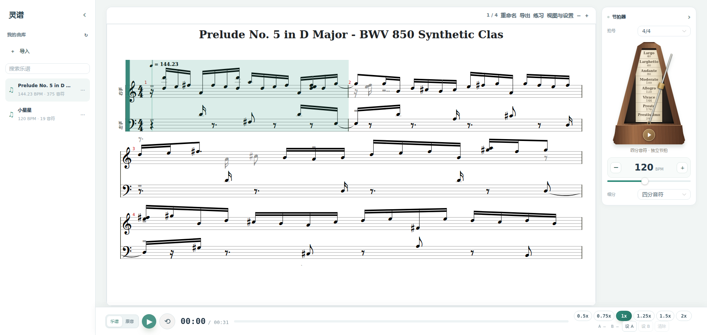

# 2026-11-06 功能迭代与验证

## 使用流程

- MusicXML / MXL 经后端解析并保存到曲库，刷新、重启后可以重新打开；重命名同时更新可下载文件中的标题。没有原音的导入曲目不提供原音下载和播放。
- 切曲请求可以取消，并以最后一次选择为准。乐谱、音频就绪状态分别维护，重复打开同一首曲目不再禁用原音。
- 按曲目保存阅读小节、缩放、节拍器折叠状态。重新排版以阅读小节为锚点；播放事件在用户开始播放或定位后才接管跟页。
- 两种音源切换保留时间位置并暂停旧音源。后台转录完成时，正在阅读的曲目保持打开，新曲目通过完成提示进入。
- 任务不存在时结束轮询；临时网络错误采用串行重试；工作进程退出时将未完成任务标记为失败。

## 练习与显示

- 保留纸页、点击、滑动、方向键翻页；新增适应宽度、适应整页、专注模式和全屏。空格播放/暂停，Escape 退出专注。
- 双音轨谱可分别调节左右手音量。原音以及单音轨导入谱会说明音量控制的适用范围。
- 可在练习面板开启一小节预备拍，使用当前乐谱 BPM、拍号和播放倍速。再次点击播放可取消预备拍，切曲、离开阅读页也会取消。
- 机械节拍器使用 Web Audio 提前调度声音，由同一个音频时钟驱动摆杆。支持 3/4、4/4、6/8；6/8 以附点四分音符为拍，默认三细分。
- 导出菜单支持打印 / 保存 PDF，在新窗口按纸张宽度重新排版。中小屏底栏将倍速和 A/B 设置收到“更多”中；实测 768×1024 时底栏高 61px。

## 重新建谱

音频转录保存 `events.json`，包含音高、起止时间、力度和踏板区间。重新建谱复用这些事件，可以修改 BPM、拍号、量化、双手分界和调号，不调用模型。首次重建旧曲目时从现有 MIDI 恢复事件。

调号默认按时长加权估计，可手动覆盖；降号调使用对应的音高拼写。双手分配以可配置的分界音高为依据，声部分配增加音高连续性选择。自动推断的结果可以通过重新建谱调整。

首次导出文件以 `original-score.mid`、`original-score.musicxml` 保留，原音和原始事件不被新参数覆盖。成品 MusicXML 导入后保留原始记谱，重新建谱入口仅针对音频转录曲目。

## 验证记录

- 后端 24 项测试通过，覆盖导入持久化、MXL、损坏文件、重命名、重建谱、原始文件保留、旧 MIDI 恢复，以及工作进程退出后的任务状态。前端单元测试、类型检查与生产构建通过；开发页面和生产预览均通过保存的浏览器回归套件。
- 浏览器回归覆盖重复开曲、网络延迟下连续切曲、阅读位置恢复、后台完成不抢占页面、预备拍、导入后刷新、紧凑播放器与控制展开。`frontend/tests/browser-regression.mjs` 拦截 API，使用固定 MusicXML 与合成 WAV，测试不会修改用户曲库。
- 隔离真实后端完成音频上传 → 排队 → 解码 → GPU 推理 → 建谱 → 下载 → 重新建谱；`events.json` 和首次导出副本均存在。转录期间健康接口最大响应时间 0.00505 秒。本次端到端参考音频输出 13 个事件，重建 BPM 为 90。
- 原生打印窗口生成 `/tmp/lingpu-print-check.pdf`，标题与完整谱面正常。浏览器测得节拍器在 120 BPM、3/4 下的调度时间为 0.06、0.56、1.06、1.56 秒，强拍频率序列为 1100、760、760、1100 Hz。
- 真实原音定位到第 8 秒后，在两种音源间往返切换仍保留该位置。取消预备拍后继续等待，音频保持暂停。

## 固定参考语料

`backend/scripts/reference_suite.py` 生成旋律、双手和弦、重复音和踏板、跨小节长音、静音五组素材，同时保存事件、参考 MIDI、MusicXML 和 WAV。音频由加法合成生成，结果适用于本次受控信号。

建谱评测从原始参考事件生成 MusicXML，再解析回 MIDI 比较：五组音符 onset / offset F1 均为 1。踏板在原始 MIDI 和事件中保留，当前 MusicXML 导回的 MIDI 没有踏板控制，重复音素材的该项得分为 0。

ByteDance 模型识别单独计算，键盘 note-off 不按踏板延长，onset 容差 50ms、offset 使用现有 mir_eval 规则：

| 素材 | 参考音符数 | onset F1 | onset + offset F1 | 推理秒数 |
|---|---:|---:|---:|---:|
| 旋律 | 8 | 0.762 | 0.762 | 0.896 |
| 双手和弦 | 12 | 0.696 | 0.348 | 0.433 |
| 重复音与踏板 | 6 | 0.714 | 0.143 | 0.430 |
| 跨小节长音 | 3 | 0.800 | 0.000 | 0.440 |
| 静音 | 0 | 1.000 | 1.000 | 0.410 |

模型加载 3.762 秒；静音的空集合匹配按测试约定记为 1。完整结果见 [reference-suite-results.json](reference-suite-results.json)。后续真实钢琴质量评估仍需使用同次演奏的人工参考 MIDI。

复现：

```bash
conda run -n lingpu python -m pytest -q
conda run -n lingpu python backend/scripts/reference_suite.py --model bytedance --device cuda
cd frontend
npm run typecheck
npm test
npm run build
# 另一个终端运行 npm run dev -- --host 127.0.0.1 --port 5175
npm run test:browser
```

前端时间调度位于 `services/beatClock.ts`，阅读偏好位于 `services/readerPreferences.ts`，机械节拍器组件独立为 `components/MechanicalMetronome.vue`；后端导入及重建谱集中在 `lingpu/library.py`。

交付时已启动原有曲库的 8000 / 5173 服务，健康检查确认 ByteDance 模型在 CUDA 上就绪。原数据库升级前的快照保存在 `backend/data/backups/before-2026-11-06-library-update.sqlite3`。


