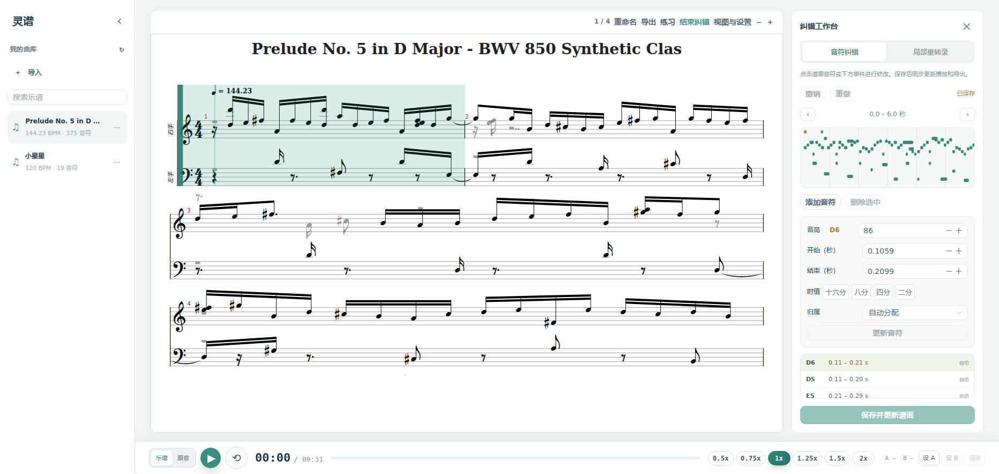

# 音符纠错与局部重转录

## 使用入口

打开一首音频转录曲目，点击谱面工具栏的“纠错”。进入独立全屏工作区，可切换“音符纠错”和“局部重转录”，原来的节拍器在结束纠错后恢复。成品 MusicXML / MXL 导入谱仍保留原始记谱。

## 音符纠错

上方乐谱与下方大尺寸音符时间图对照显示，拖动中间分隔条可调整高度。点击谱面音符，或在时间图、事件列表中选中音符。拖动音符改变音高与开始位置，拖动右边缘改变时长；可切换十六分吸附并缩放时间范围。可以修改 MIDI 音高、开始 / 结束时间、常用时值、力度及左右手归属，也可以添加或删除音符。

“更新音符”将表单修改放入当前草稿；直接点击“保存并更新谱面”也会一并应用表单。保存成功后重新生成 MusicXML 和 MIDI，合成播放和下载使用新结果。原录音保持不变。

撤销 / 重做首先处理尚未保存的草稿，再处理已保存版本。已保存历史存放在 SQLite，刷新和服务重启后仍可撤销。撤销后再提交新的修改会结束原来的重做分支。切曲、离开纠错及关闭页面时，会保护尚未保存的修改。

## 局部重转录

可以载入原音波形并拖动框选，也可在音符图中框选，或按原录音的绝对秒数填写开始和结束，也可以用当前播放位置设置边界。先通过“试听所选原音”确认片段，再点击“重新识别片段”。

识别由原有单消费者 GPU 工作进程执行。模型输入包含选择前后各最多 0.75 秒的上下文，输出重新放回原录音时间轴。结果完成后用金色音符叠加对照，并显示音符数量和列表，点击“应用替换结果”才写回当前曲目；也可以放弃。

替换范围按音符起点定义为 `[开始, 结束)`。起点在范围外的音符保留原始标识、音高、时间、力度和手别；选择前已经按住的长音保留，同音的新预测不会截短它。新预测音符的结束时间限制在片段末尾。若需要改正跨边界长音，请把它原来的起点包含进选择范围。踏板按区间合并，保留片段外的状态。

局部替换也进入相同的历史，可以撤销 / 重做。识别任务保存在浏览器中，刷新后重新进入该曲目的纠错工作台，可继续查询结果。识别期间曲目被另一个页面或其他操作更新时，旧结果会因版本不符而拒绝应用，避免覆盖较新的修改。

## 数据与接口

音符具有稳定 `id` 和可选 `hand`（`right`、`left` 或自动）。现有曲目首次打开时自动从事件文件或 MIDI 迁移，初始记录随之保存。原始事件和首次导出文件保留为 `original-events.json`、`original-score.mid`、`original-score.musicxml`。

| 方法 | 接口 | 用途 |
|---|---|---|
| GET | `/api/scores/{id}/events` | 当前音符、版本、建谱参数和撤销状态 |
| PUT | `/api/scores/{id}/events` | 提交完整音符草稿和 `expected_revision` |
| POST | `/api/scores/{id}/history/undo`、`redo` | 撤销 / 重做，携带当前版本 |
| POST | `/api/scores/{id}/retranscriptions` | 提交开始、结束和当前版本，返回任务 ID |
| GET | `/api/scores/{id}/retranscriptions/{task}` | 查看待确认的结果 |
| POST | `/api/scores/{id}/retranscriptions/{task}/apply` | 确认应用，携带当前版本 |

曲目文件锁覆盖 API 线程和推理进程；写入前先完成全部建谱，并保存原文件。数据库版本检查防止过期提交，写入异常会回滚文件。重新建谱也通过同一套版本提交逻辑执行。

## 验证

- 后端 32 项测试通过，新增覆盖修改后 MIDI / MusicXML、手别、增删、撤销 / 重做分支、服务重启、无效数据、失败回滚、旧版本冲突、长音 / 踏板边界、重复应用保护和只推理局部输入。
- 前端新增量化音符映射、连音和重复音选择、手别选择测试；类型检查及生产构建通过。
- 实际 Chromium + 隔离曲库验证了谱面点击选音、修改音高 / 时值 / 手别、增删、撤销、未保存保护，以及真实 ByteDance CUDA 局部推理。应用前曲目不变，应用后按音符 ID 核对片段外事件保持不变，撤销可恢复替换前结果。
- `frontend/tests/correction-browser.mjs` 的受控接口回归通过，覆盖纠错、持久历史、未保存保护、刷新后任务恢复、确认应用和撤销。测试不会修改真实曲库。
- 已在 5173 提供的生产构建上复跑纠错及通用浏览器回归，均通过。真实后端 CUDA 模型就绪，原有两首曲目保留；首次打开纠错工作台完成稳定标识迁移，未提交音符改动的曲目版本仍为 0。



```bash
conda run -n lingpu python -m pytest -q
cd frontend
npm run typecheck
npm test
npm run build
# 另一个终端启动 npm run dev -- --host 127.0.0.1 --port 5176
npm run test:correction
# 可用 LINGPU_TEST_URL 指向其他开发或生产预览端口
```
