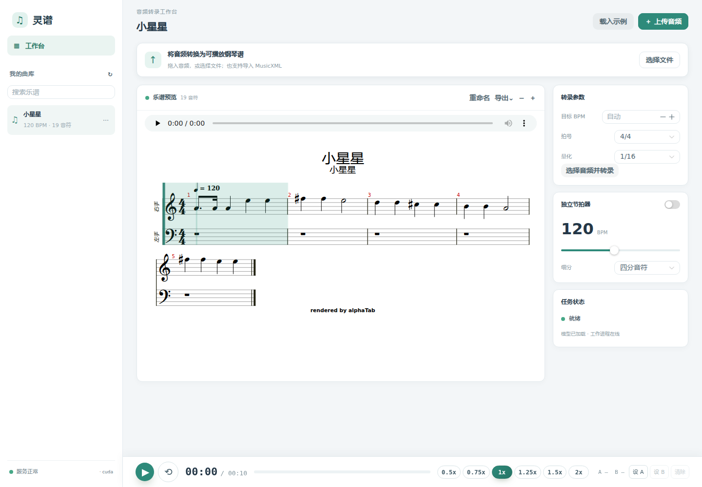

# 本轮验证记录

后续的曲库保存、练习、重新建谱与浏览器回归见 [2026-11-06 验证记录](iteration-2026-11-06.md)。下文保留 10 月迭代时的运行结果。

日期：2026-10-25。环境：WSL/Linux，Python 3.11、PyTorch 2.8.0+cu128、RTX 5090 D v2、Node 22.23.2。

## 自动检查

- 后端 pytest：19 项通过。覆盖 API 参数/空文件/大小限制、曲库 CRUD 与下载、任务恢复、解码、工作进程产物、音符/踏板、双手/和弦/重复音/连音/中文曲名、模型输出裁剪与权重完整性、评测单位与空集。
- 前端：TypeScript 类型检查通过，11 项 Node 测试通过，生产构建通过。
- Ruff 基础检查及 Python 格式化通过；前端已按 Prettier 统一格式；Git diff 空白检查通过。

## 实际运行检查

- GPU 张量乘法通过；ByteDance 与 Transkun 在同一 10 秒纯钢琴片段上完成 CUDA 推理，数据见 benchmark-report.md。
- 实际 HTTP 上传 10 秒《小星星》：202 返回任务 ID，完成后19音符、MIDI/MusicXML均可下载，alphaTab读取两轨、每轨5小节。
- 31 秒片段在独立推理进程中分段执行，观察到14%至100%的真实推理进度；同时健康接口最慢约0.0083秒。超出600秒的音频、损坏文件均正确失败并返回中文原因。
- 2 秒静音实际推理完成，音符数为0，生成休止乐谱，未报错误。
- Chromium 实际操作：上传后刷新恢复、完成后打开乐谱、重命名、搜索、删除、清空谱面均通过；控制台无错误。
- 双手谱均显示；播放和暂停有效。2x/0.5x下seek和曲长换算通过；A/B循环由tick范围驱动，B必须晚于A。
- 独立节拍器启用后产生节拍声音节点，关闭后不再生成；细分不改变每四拍一次的强拍周期。
- 生产构建使用Vite preview实际打开、加载双手谱并合成播放，控制台无错误。

## 已知限制与后续

构建仍有alphaTab上游的 `import.meta`/IIFE提示及较大chunk提示；已验证当前生产构建的乐谱读取与播放正常。测试库存在Starlette/httpx的弃用提示，目前不影响通过。

没有真实参考MIDI的素材不报告准确率或F1。实际钢琴转录效果和节奏量化仍需人工校对；左右手分配为启发式。没有完成用户明确暂缓的自动翻页、跟谱节拍器时钟同步、播放器资源释放专项优化和平板专门适配。

## 浏览器反馈修复：原音跟谱与横向滚动条

原音 play/timeupdate/seeked 驱动 alphaTab 时间位置与纵向跟随，原音和合成播放互斥。谱面使用自动换行、无水平内边距及隐藏横向滚动条；滚动限定在谱面容器内。

1575×884 Chromium 验证：10秒原音从1秒跳到7秒时光标位置随之改变；31秒乐谱跳到28秒后容器 scrollTop=195（可视高524、内容高719），无控制台错误；容器 clientWidth 与 scrollWidth 均为971，无水平溢出。TypeScript检查、11项前端测试及生产构建通过。此处按转录的秒级时间轴跟随，不包含实时听音定位或自由速度演奏的逐音对齐。
